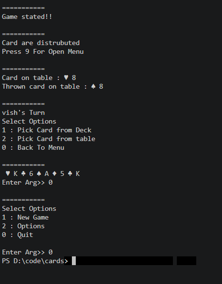

# Compile 
java "-Dfile.encoding=UTF-8" "-Dstdout.encoding=UTF-8" cardsMain

# Run using this
java "-Dfile.encoding=UTF-8" "-Dstdout.encoding=UTF-8" cardsMain

# To run on powershell
chcp 65001
[Console]::OutputEncoding = [System.Text.Encoding]::UTF8
java "-Dfile.encoding=UTF-8" "-Dstdout.encoding=UTF-8" cardsMain

# Game in terminal

